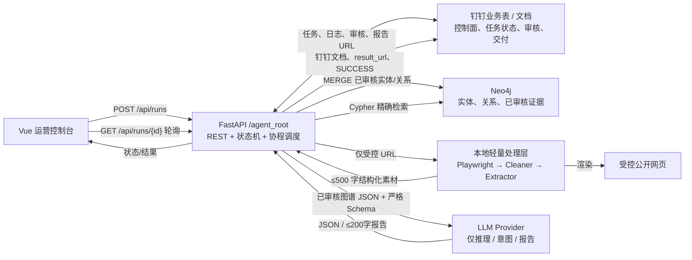
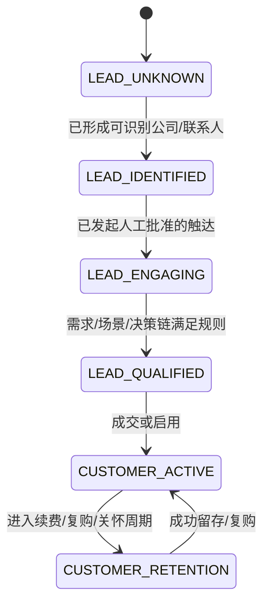
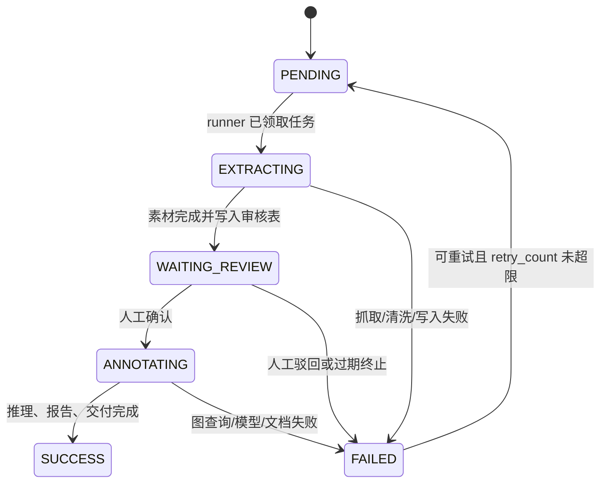

# AIGC 运营获客与留存 Agent 技术规格说明书（Spec）v4.0

> 状态：可开发基线  
> 版本：v4.0  
> 更新时间：2026-07-14  
> 读者：后端、算法/数据、前端、测试、运维与钉钉管理员

## 0. 现有项目核对与本规格边界

### 0.1 已有基础（As-is）

当前仓库是一个可运行的 Next.js 14 + TypeScript P0 演示产品，面向电机销售拓客。现有能力包括：线索新增与详情、规则评分、关键词式知识匹配、可选 OpenAI-compatible 话术生成、产品/知识条目管理和跟进时间线。持久化目前使用 [`data/app-data.json`](../data/app-data.json)，服务入口为 Next.js Route Handlers。

现有实现中可复用的业务资产：

| 资产 | 位置 | v4.0 去向 |
| --- | --- | --- |
| 线索、产品、知识的演示数据 | `data/app-data.json` | 一次性导入钉钉业务表；审核后写入 Neo4j |
| 规则评分与解释 | `src/server/scoring/` | 迁移为 `core/profiler.py` 的确定性规则层 |
| 话术生成与模型 Provider | `src/server/agents/`、`src/server/llm/` | 迁移为 `core/inquiry.py` + `services/llm_provider.py` |
| Leads / Products / Knowledge 页面 | `src/app/` | Vue 生产控制台的交互原型与字段参考 |

### 0.2 本规格的目标（To-be）

v4.0 新增一个独立的 Python 后端服务根目录 `/agent_root`，不把 FastAPI、Neo4j 驱动和爬虫逻辑塞入现有 Next.js Route Handler。现有 Next.js P0 可继续作为演示前端；生产 Vue 控制台通过 REST 调用该服务。两套前端不得直接访问 Neo4j、钉钉密钥或 GPT 接口。

本 Spec 定义的是生产架构与接口契约，不要求本次直接替换已有 P0 UI。

## 1. 架构原则与非目标

### 1.1 强制原则

1. **去 Token 化。** 禁止将 HTML 源码、大规模原文、DOM 树或未清洗网页直接发送给任意 LLM Provider。所有网页先经本地渲染、清洗、抽取、截断；每一条可供模型使用的素材 JSON 序列化后上限为 500 个中文字符（或 1,500 UTF-8 bytes，取更小者）。
2. **LLM 只做高价值推理。** 由配置选定的模型 Provider 仅用于决策推理、意图理解、报告生成；不得用于爬取、HTML 清理、实体初筛、去重或字段抽取。
3. **四服务解耦。** 钉钉是运营控制面与状态总线；Neo4j 是关系知识库；FastAPI 是编排与计算引擎；LLM Provider 是模型层。每一层只能经服务接口交互。
4. **状态先持久化再执行。** 所有状态转换先以乐观锁写入钉钉业务表，再启动下一步；任务执行必须可重试、可审计、可恢复。
5. **人审是质量闸门。** 未经人工确认的抓取素材不得进入 LLM 推理阶段，不得生成对外动作。
6. **最小权限与可追溯。** 所有密钥只来自环境变量；每一次模型调用、图查询、状态迁移和人工确认必须关联 `run_id` 与审计日志。

### 1.2 非目标

- P0/P1 不建设通用搜索引擎、全网无界爬虫、自动外呼或自动发送外部消息。
- P0/P1 不以 LLM 输出直接修改客户生命周期；状态推进由规则、人工动作或已记录的业务事件驱动。
- 不把钉钉业务表 当成高并发事务数据库，也不把 Neo4j 当作任务队列。
- 不引入 Celery；任务执行采用受控的 asyncio 协程池。横向扩容前必须引入单消费者租约/分布式锁，见第 10 节。

## 2. 总体架构与数据流



### 2.1 责任边界

| 组件 | 负责 | 禁止负责 |
| --- | --- | --- |
| Vue | 发起任务、展示状态/日志、人工确认、跳转报告 | 访问钉钉/Neo4j/GPT；直接改变状态字段 |
| FastAPI | 参数校验、状态机、任务调度、服务编排、幂等、审计 | 存储长期关系事实；将原始 HTML 交给 LLM |
| 钉钉业务表/文档 | 运营控制面、业务状态、审核队列、面向运营的结果交付 | 图关系推理、事务队列、高频分析 |
| Neo4j | 已审核实体、关系、证据与时间关系查询 | 存放 HTML、未审核抓取全文、密钥 |
| 本地处理层 | 页面渲染、HTML 清洗、正则/轻量 NER、摘要截断 | 调用 GPT 或做业务决策 |
| LLM Provider | 基于受控 JSON 的决策/意图/报告 | 抽取网页、自由编造事实、数据库写入 |

## 3. 双状态机

### 3.1 用户生命周期（宏观）



生命周期存为 Neo4j 的 `User.lifecycle_state`，并在钉钉业务表显示镜像值。只有 `lifecycle.py` 可以提出迁移；写入需包含 `reason`、`actor_type`（RULE/HUMAN/INTEGRATION）和证据 ID。

### 3.2 任务执行状态（微观）



状态迁移白名单：`PENDING→EXTRACTING→WAITING_REVIEW→ANNOTATING→SUCCESS`，异常仅可进入 `FAILED`；`FAILED→PENDING` 仅允许人工或受控重试器执行。`SUCCESS` 与 `FAILED` 是终态。Base 更新必须携带 `version`，条件不满足返回 409，防止双 worker 重复执行。

## 4. 工程目录与运行时

生产服务根目录严格采用以下结构。现有仓库可将它作为后端子目录或独立部署仓库，但部署根必须是 `/agent_root`。

```text
/agent_root/
├── docker-compose.yml
├── .env.example
├── requirements.txt
├── src/
│   ├── main.py
│   ├── api/
│   │   ├── v1_routes.py
│   │   └── schemas.py
│   ├── core/
│   │   ├── profiler.py
│   │   ├── inquiry.py
│   │   ├── dispatch.py
│   │   └── lifecycle.py
│   ├── services/
│   │   ├── dingtalk_client.py
│   │   ├── neo4j_client.py
│   │   ├── llm_provider.py
│   │   ├── openai_compatible_provider.py
│   │   └── sse_publisher.py
│   ├── processors/
│   │   ├── renderer.py
│   │   ├── cleaner.py
│   │   └── extractor.py
│   └── tasks/
│       ├── task_runner.py
│       ├── step1_crawl.py
│       └── step3_ai_annotate.py
└── tests/
    ├── unit/
    └── integration/
```

### 4.1 文件职责契约

| 文件 | 唯一职责 | 不得做 |
| --- | --- | --- |
| `main.py` | 创建 FastAPI、生命周期钩子、依赖注入、挂载 `/api` | 编写业务规则或 Cypher |
| `api/v1_routes.py` | HTTP 解析、鉴权、调用编排服务、HTTP 映射 | 直接访问 SDK/Driver |
| `api/schemas.py` | Pydantic v2 请求/响应与枚举 | 业务实现 |
| `core/*.py` | 模块业务规则、输入输出 DTO、编排决定 | HTTP、环境变量读取、SDK 细节 |
| `services/*.py` | 单一外部系统适配器 | 业务状态决策 |
| `processors/*.py` | 本地采集/清洗/抽取 | LLM 或 Neo4j 调用 |
| `tasks/*.py` | 状态机驱动、重试、步骤编排 | 直接处理 HTTP Request |

### 4.2 配置模板

`.env.example` 至少包含以下字段，真实 `.env` 不得提交版本库：

```dotenv
APP_ENV=development
APP_HOST=0.0.0.0
APP_PORT=8000
TASK_POLL_INTERVAL_SECONDS=10
TASK_CONCURRENCY=4
TASK_MAX_RETRIES=3

DINGTALK_APP_KEY=
DINGTALK_APP_SECRET=
DINGTALK_AGENT_ID=
DINGTALK_CONTROL_APP_ID=
DINGTALK_TASK_TABLE_ID=
DINGTALK_MATERIAL_TABLE_ID=
DINGTALK_ADMIN_OPEN_ID=

NEO4J_URI=bolt://neo4j:7687
NEO4J_USERNAME=neo4j
NEO4J_PASSWORD=

LLM_PROVIDER=openai_compatible
LLM_API_KEY=
LLM_BASE_URL=https://api.openai.com/v1
LLM_MODEL=
LLM_TOKEN_WARN_THRESHOLD=2000
LLM_CONSECUTIVE_WARN_THRESHOLD=5

PLAYWRIGHT_TIMEOUT_MS=20000
CRAWL_ALLOWED_DOMAINS=
```

`docker-compose.yml` 仅编排 `api` 与 `neo4j` 两个容器；钉钉与 GPT 为托管外部服务。Neo4j 数据卷必须命名持久化，API 健康检查应依赖 Neo4j healthcheck。开发容器安装 Chromium 及 Playwright 所需系统依赖，生产建议将渲染器隔离为受限 worker 镜像。

## 5. API 契约（Vue ↔ FastAPI）

统一前缀：`/api`。所有时间字段使用 ISO-8601 UTC。所有失败响应采用 `{ "code": <http_status>, "message": "...", "request_id": "..." }`。Vue 每 5 秒轮询非终态任务，终态后停止；推荐最大退避至 15 秒。

### 5.1 创建任务：`POST /api/runs`

请求：

```json
{
  "task_type": "profiler",
  "params": {
    "industry": "航空",
    "seed_urls": ["https://example.com/news/123"],
    "user_id": "usr_01"
  },
  "idempotency_key": "vue-4a0e23e5-5b55-4d44-a4f0-5b2d7a8c3e01"
}
```

字段约束：

| 字段 | 类型 | 约束 |
| --- | --- | --- |
| `task_type` | enum | `profiler`、`inquiry`、`dispatch`、`lifecycle` |
| `params` | object | 最大 16 KB；禁止传 HTML/raw_text；`seed_urls` 最多 10 条且必须命中 allowlist |
| `idempotency_key` | string | 16–128 字符，同一调用方 24 小时内唯一 |

处理：校验后在钉钉「任务表」创建 `PENDING` 记录，`params_json` 存规范化 JSON；以 `idempotency_key` 去重。成功立即返回，严禁同步抓取或调用模型。

响应：HTTP `202 Accepted`。

```json
{
  "code": 202,
  "run_id": "run_01J00000000000000000000000",
  "status": "PENDING",
  "poll_url": "/api/runs/run_01J00000000000000000000000"
}
```

### 5.2 查询任务：`GET /api/runs/{run_id}`

FastAPI 从钉钉任务表读取当前状态与可展示字段，必要时补充只读图谱摘要；不向浏览器返回密钥、原始 HTML、内部 Cypher 或完整模型 Prompt。

响应：HTTP `200 OK`。

```json
{
  "run_id": "run_01J00000000000000000000000",
  "task_type": "profiler",
  "status": "WAITING_REVIEW",
  "lifecycle_state": "LEAD_IDENTIFIED",
  "created_at": "2026-07-14T02:00:00Z",
  "updated_at": "2026-07-14T02:01:12Z",
  "progress": {"step": "review", "percent": 55},
  "logs": [
    {"at": "2026-07-14T02:00:15Z", "level": "INFO", "event": "MATERIAL_EXTRACTED", "message": "已生成 2 条待审核素材"}
  ],
  "review": {"required": true, "approved_count": 0, "rejected_count": 0},
  "result": null,
  "error": null
}
```

`SUCCESS` 时 `result` 至少包含 `result_url`（钉钉文档超链接）和受限摘要；`FAILED` 时返回稳定 `error.code` 与对运营可读的 `error.message`，但不泄漏堆栈。

### 5.3 人工确认：`POST /api/runs/{run_id}/confirm`

请求：

```json
{
  "reviewer_id": "ou_xxx",
  "approved_material_ids": ["mat_001", "mat_002"],
  "rejected_material_ids": ["mat_003"],
  "comment": "保留公司与产品相关内容，排除招聘信息。",
  "expected_version": 4
}
```

规则：任务必须处于 `WAITING_REVIEW`；至少批准一条材料；`approved_material_ids` 与 `rejected_material_ids` 不可交叉；审核人必须有 Base 对应权限。后端以一条 Base 审核日志和版本条件更新，将任务状态改为 `ANNOTATING`，再由 runner 领取。

响应：HTTP `202 Accepted`。

```json
{
  "code": 202,
  "run_id": "run_01J00000000000000000000000",
  "status": "ANNOTATING"
}
```

错误：状态不符为 409；版本不符为 409；材料不属于该 run 为 422；未授权为 403；不存在为 404。

## 6. 核心处理流水线

### 6.1 阶段 0：触发与持久化

`v1_routes.py` 调用 `dingtalk_client.create_task_record()`，生成 `run_id`（ULID）、初始 `version=1`、`status=PENDING`。任务参数仅存已验证的规范 JSON；URL、行业、用户 ID 必须拆为可查询字段，不能只埋在 JSON 内。

### 6.2 阶段 1：工程化采集（零 LLM）

`task_runner.py` 每 10 秒查询钉钉业务表中符合 `PENDING` 且无活跃租约的任务，原子认领后进入 `EXTRACTING`。

```text
受控 URL
  → renderer.render(url)          # Playwright；超时、域名 allowlist、robots/合规策略
  → cleaner.to_document(html)     # 移除 script/style/nav/footer；保留 title/headings/links/text
  → extractor.compact(document)   # Regex + spaCy 轻量模型；NER、邮箱、公司、人名、摘要
  → validate_material()           # 字符数、PII、schema、重复 URL/哈希校验
  → Neo4j（候选证据）+ 钉钉素材审核表
  → WAITING_REVIEW
```

强制输出契约（单素材）：

```json
{
  "material_id": "mat_001",
  "summary": "某航空供应链企业发布了无人机云台稳定控制方案，提及微型无刷驱动与低噪声需求。",
  "entities": [
    {"name": "示例公司", "type": "Company", "confidence": 0.93},
    {"name": "无人机云台", "type": "Product", "confidence": 0.88}
  ],
  "contacts": {"emails": ["bd@example.com"], "people": []},
  "meta": {"url": "https://example.com/news/123", "title": "...", "published_at": null, "content_hash": "sha256:..."}
}
```

`summary + entities + contacts + meta` 的序列化长度不得超过上限。超过即在本地二次压缩，仍超限则以 `MATERIAL_TOO_LARGE` 标记失败；不能绕过限制调用 GPT。

未审核素材可写入 Neo4j 的 `CandidateEvidence` 节点以方便追踪，但不得连接到可用于模型检索的正式业务关系。审核批准后才提升为 `Evidence` 并参与图查询。

### 6.3 阶段 2：人工审核

Vue 展示 Base 素材审核表的摘要、实体、来源链接与审核结果，不展示源 HTML。审核者逐条批准/驳回。批准素材提升为正式图谱事实；被拒绝素材保留最小审计信息与原因，原始渲染结果按数据保留策略删除。

### 6.4 阶段 3：图谱检索 + LLM Provider 推理

`step3_ai_annotate.py` 只能使用审核批准的 `Evidence` 和确定性用户画像组成上下文。例：查询最近 30 天内与目标行业关联度最高的五条证据。

```cypher
MATCH (u:User {id: $user_id})-[:INTERESTED_IN]->(i:Industry)<-[:RELATED_TO]-(e:Evidence)
WHERE e.approved_at >= datetime() - duration('P30D')
RETURN e.id AS evidence_id, e.summary AS summary, e.source_url AS source_url,
       i.name AS industry
ORDER BY e.approved_at DESC
LIMIT 5
```

查询返回先经 `GraphContext` Pydantic 校验和 500 字/证据截断，再传给 `llm_provider.py`。模型请求开启 JSON Schema / structured output；服务端再次用 Pydantic 强校验，失败最多修复重试一次，仍失败则任务 `FAILED`，错误码 `LLM_SCHEMA_INVALID`。

模块输出：

| 模块 | 确定性输入 | 模型允许输出 |
| --- | --- | --- |
| `profiler.py` | 行业、已审核实体、规则评分 | 画像优先级、缺失字段、下一步研究建议 JSON |
| `inquiry.py` | 画像、已审核证据、场景约束 | 需求探查问题与话术导航 JSON |
| `dispatch.py` | 场景目录、视频映射、图谱上下文 | `{scenario, confidence, rationale, video_key}`；URL 由后端白名单映射 |
| `lifecycle.py` | 生命周期、互动事件、留存证据 | 200 字内关怀/挽留文案或结构化下一步建议 |

**禁止模型输出任意视频 URL、Cypher、状态迁移命令或未在证据中存在的事实。** 视频链接须由 `video_key` 在后端静态/数据库白名单中解析。

### 6.5 阶段 4：交付

模型输出经 schema、敏感词与事实引用检查后，`dingtalk_client.create_document()` 生成钉钉文档。文档包含：运行摘要、审核证据链接、决策输出、人工审核人与时间、免责声明。成功写入任务表 `result_url` 和 `status=SUCCESS`。写文档失败不得置 SUCCESS。

## 7. Neo4j 图谱 Schema

### 7.1 节点与约束

| 节点 | 必需属性 | 说明 |
| --- | --- | --- |
| `User` | `id`, `name`, `lifecycle_state`, `created_at` | 线索/客户联系人 |
| `Company` | `id`, `name`, `normalized_name`, `industry` | 公司账户 |
| `News` | `id`, `title`, `published_at`, `source_url` | 可单独建模的新闻/内容 |
| `Evidence` | `id`, `summary`, `source_url`, `content_hash`, `approved_at`, `run_id` | 已审核、可检索的短证据 |
| `CandidateEvidence` | `id`, `summary`, `source_url`, `run_id`, `review_status` | 未审核隔离区 |
| `Industry` | `id`, `name` | 行业词典 |
| `Scenario` | `id`, `name`, `video_key` | 场景与受控视频映射 |

必建约束/索引：

```cypher
CREATE CONSTRAINT user_id IF NOT EXISTS FOR (n:User) REQUIRE n.id IS UNIQUE;
CREATE CONSTRAINT company_id IF NOT EXISTS FOR (n:Company) REQUIRE n.id IS UNIQUE;
CREATE CONSTRAINT news_id IF NOT EXISTS FOR (n:News) REQUIRE n.id IS UNIQUE;
CREATE CONSTRAINT evidence_id IF NOT EXISTS FOR (n:Evidence) REQUIRE n.id IS UNIQUE;
CREATE CONSTRAINT candidate_evidence_id IF NOT EXISTS FOR (n:CandidateEvidence) REQUIRE n.id IS UNIQUE;
CREATE INDEX company_normalized_name IF NOT EXISTS FOR (n:Company) ON (n.normalized_name);
CREATE INDEX evidence_approved_at IF NOT EXISTS FOR (n:Evidence) ON (n.approved_at);
```

### 7.2 关系

| 关系 | 起点 → 终点 | 属性 | 语义 |
| --- | --- | --- | --- |
| `INTERESTED_IN` | `User → Industry` | `source`, `confidence`, `updated_at` | 用户行业/主题兴趣 |
| `MENTIONED_IN` | `Company/User → News/Evidence` | `role`, `confidence`, `run_id` | 被内容或证据提及 |
| `EMPLOYED_BY` | `User → Company` | `title`, `verified_at` | 联系人与公司 |
| `RELATED_TO` | `Evidence/News → Industry/Scenario` | `confidence`, `extractor_version` | 已审核关联 |
| `DERIVED_FROM` | `Evidence → News` | `source_url`, `content_hash` | 证据来源追溯 |
| `SUGGESTS` | `Evidence → Scenario` | `confidence`, `approved_by` | 支持场景判断 |

所有写入采用参数化 `MERGE`，按 `normalized_name + domain` 做公司消歧候选；自动合并低置信实体被禁止，须进入人工审核。

## 8. 钉钉业务表与钉钉文档 Schema

### 8.1 任务表（`Tasks`）

| 列名 | 类型 | 必填 | 说明 |
| --- | --- | --- | --- |
| `run_id` | 文本（唯一） | 是 | ULID，所有系统关联主键 |
| `task_type` | 单选 | 是 | profiler/inquiry/dispatch/lifecycle |
| `status` | 单选 | 是 | 微观任务状态机枚举 |
| `version` | 数字 | 是 | 乐观锁版本 |
| `params_json` | 多行文本 | 是 | 已校验 JSON，最大 16 KB |
| `user_id` | 文本 | 否 | 图谱 User ID |
| `industry` | 单选或文本 | 否 | 便于运营筛选 |
| `lifecycle_state` | 单选 | 否 | 宏观状态镜像 |
| `progress_percent` | 数字 | 是 | 0–100 |
| `logs` | 多行文本 | 否 | 仅运营可读的结构化日志摘要 |
| `retry_count` | 数字 | 是 | 默认 0 |
| `lease_until` | 日期时间 | 否 | worker 领取租约 |
| `idempotency_key` | 文本 | 是 | 请求去重 |
| `result_url` | 超链接 | 否 | 钉钉文档报告 |
| `error_code` | 文本 | 否 | 稳定错误码 |
| `error_message` | 多行文本 | 否 | 脱敏错误说明 |
| `created_at` | 创建时间 | 是 | 平台自动字段 |
| `updated_at` | 最后编辑时间 | 是 | 平台自动字段 |

### 8.2 素材审核表（`MaterialReview`）

| 列名 | 类型 | 必填 | 说明 |
| --- | --- | --- | --- |
| `material_id` | 文本（唯一） | 是 | 素材 ID |
| `run_id` | 关联记录 → Tasks | 是 | 所属任务 |
| `source_url` | 超链接 | 是 | 受控公开来源 |
| `source_title` | 文本 | 否 | 标题 |
| `summary` | 多行文本 | 是 | 500 字以内的清洗摘要 |
| `entities_json` | 多行文本 | 是 | 已抽取实体 JSON |
| `emails_masked` | 多行文本 | 否 | 邮箱掩码展示；原值仅受控存储 |
| `content_hash` | 文本 | 是 | 去重和可追溯 |
| `review_status` | 单选 | 是 | PENDING/APPROVED/REJECTED |
| `reviewer` | 人员 | 否 | 审核人 |
| `review_comment` | 多行文本 | 否 | 审核意见 |
| `approved_at` | 日期时间 | 否 | 批准时间 |
| `raw_snapshot` | 附件 | 否 | 默认不存；合规需要时以受控快照保存 |
| `extractor_version` | 文本 | 是 | 清洗/抽取规则版本 |

### 8.3 文档模板

报告钉钉文档必须含标题 `【Agent】{task_type} - {run_id}`，至少包括：任务元信息、状态/时间、人工审核摘要、证据清单（链接）、图谱检索摘要、AI 输出、风险/未确认项、审计附录。不得在钉钉文档写入完整 Prompt、API Key、完整原网页或未掩码敏感信息。

## 9. LLM Provider 层与成本控制

`llm_provider.py` 定义唯一允许由业务层依赖的模型接口；具体供应商适配器只能在 `services/` 内实现，业务代码不得依赖特定模型 SDK。

初版内置 `openai_compatible` 适配器，可通过 `LLM_BASE_URL` 与 `LLM_MODEL` 选择任意兼容 Chat Completions 与 JSON 输出的服务。未来增加其他供应商时，只新增对应 Provider 并注册到工厂，不改变 `core/`、`tasks/` 或 API 契约。

### 9.1 调用前后控制

1. 输入只接受 Pydantic `GraphContext`，拒绝 `html`、`raw_text`、`page_content` 字段。
2. 发送前使用模型兼容 tokenizer 估算 input token，设置 `max_output_tokens`；请求体记录哈希而非原文。
3. 系统提示固定说明：仅使用提供证据；证据不足返回 `insufficient_evidence`；严格按 JSON Schema 输出。
4. 返回后读取 provider usage；无 usage 时按本地估算写入。解析输出必须经 Pydantic 校验。
5. 输出自然语言的留存报告限制 200 个中文字符；其余模块只返回 JSON。

### 9.2 告警策略

当单次 `prompt_tokens + completion_tokens > 2000` 时，写 `TOKEN_OVERAGE` 审计日志，包含 `run_id`、任务类型、输入/输出 token、清洗器版本与模型名。连续五个完成的模型调用均超过阈值时，调用钉钉管理员消息接口发送告警；如组织另行配置钉钉/企微 webhook，可由同一 `AlertPublisher` 适配，但不得在业务模块中直接发消息。

连续计数按模型+环境隔离；一条未超阈值调用应清零。告警本身失败不得影响主任务，但必须记录 `ALERT_DELIVERY_FAILED`。

## 10. 可靠性、安全与可观测性

### 10.1 任务执行与重试

- 单实例：`asyncio.TaskGroup` + `Semaphore(TASK_CONCURRENCY)`；API 进程启动和关闭时创建/取消 runner。
- 任务领取：先在钉钉写 `lease_until` 与 `status=EXTRACTING/ANNOTATING`；租约有效期内其他 worker 不得领取。
- 多实例：钉钉业务表 无强事务保障，因此 v4.0 初版限制一个 active runner。横向扩容前必须增加 Redis/数据库租约服务或独立队列；不可只提高 worker 数。
- 重试：网络超时、429、5xx 可指数退避，最多 `TASK_MAX_RETRIES`；HTML 过大、schema 失败、人工拒绝、URL 非 allowlist 不重试。
- 每个外部调用都设 connect/read timeout、request_id、结构化日志与错误码。

### 10.2 抓取安全

- 只抓取显式 allowlist 与合规允许的公开站点；遵循站点条款、robots 策略及适用法律。
- 禁止访问内网 IP、localhost、file 协议和重定向后的非 allowlist 地址，防止 SSRF。
- Playwright 禁止下载、禁止持久 Cookie、禁用不必要权限；每 URL 设置超时、最大重定向数和响应体上限。
- PII 最小化：邮箱用于业务需经授权，展示和模型上下文一律脱敏；不抓取登录墙、个人私密资料或敏感个人信息。

### 10.3 监控指标

| 指标 | 维度 | 告警 |
| --- | --- | --- |
| `run_status_count` | task_type/status | PENDING 超 1 小时、WAITING_REVIEW 超 2 小时 |
| `task_duration_seconds` | task_type/step/outcome | P95 超 SLA |
| `crawl_failure_count` | domain/error_code | 连续异常增长 |
| `material_char_count` | extractor_version | 接近 500 字阈值激增 |
| `llm_tokens_total` | model/task_type | 单次 > 2000、连续 5 次超标 |
| `llm_schema_failure_count` | task_type/model | > 1% 需排查 |
| `dingtalk_api_failure_count` | operation/status | 认证/限流异常 |

钉钉业务表 自动化提醒需在每日 09:00 执行：`PENDING` 超过 1 小时或 `WAITING_REVIEW` 超过 2 小时的任务，向管理员发送钉钉消息。此提醒是兜底，实时任务告警由后端监控负责。

## 11. 测试与验收标准

### 11.1 必测用例

| 层 | 验收 |
| --- | --- |
| API | 创建返回 202；重复幂等键不重复建任务；非法 HTML 参数返回 422；状态不符确认返回 409 |
| 状态机 | 所有合法/非法迁移覆盖；并发确认只有一个成功；FAILED 重试上限生效 |
| 处理器 | HTML 中 script/style/nav 被清除；提取结果 <= 500 字；实体/邮箱正确提取并脱敏；无模型调用 |
| 图谱 | 约束生效；审核前 CandidateEvidence 不出现在推理查询；批准后关系可检索 |
| LLM | 非 GraphContext 拒绝；JSON schema 无效进入失败；超 2000 token 记录；连续 5 次触发告警 |
| 钉钉 | 任务、审核素材、报告 URL 正确写入；失败不置 SUCCESS |
| E2E | `PENDING → EXTRACTING → WAITING_REVIEW → ANNOTATING → SUCCESS` 全链路；用户能从 Vue 打开 result_url |

### 11.2 发布门槛

- 单元测试与集成测试通过；关键状态机、清洗器、token 守卫覆盖率不低于 80%。
- `docker compose up` 后 API `/healthz` 与 Neo4j 连通；缺失任何必需环境变量时应用 fail fast。
- 以包含 50 KB HTML 的测试页面验证：模型请求中无 HTML，最终上下文不超过预设 token/字符阈值。
- 对五次连续超阈值模拟调用验证仅产生一次去重告警；下一次正常调用后连续计数重置。

## 12. 从现有 P0 的实施顺序

1. 建立 `/agent_root` 的 Docker、环境变量、FastAPI 健康检查与 Neo4j 约束，不修改当前 Next.js 演示路径。
2. 建立钉钉 Tasks/MaterialReview 表及 `dingtalk_client`，实现 `/api/runs`、查询、确认三条接口与状态机测试。
3. 实现 processors 与 `step1_crawl`，先接 allowlist 测试站点，验证零 LLM 的采集/审核闭环。
4. 实现正式 Evidence 提升、Neo4j 查询与 `llm_provider` 的 JSON/token 守卫；接入 profiler、inquiry、dispatch、lifecycle 四模块。
5. 实现钉钉文档报告、监控与 Base 自动化提醒；完成 E2E。
6. Vue 仅替换数据来源：先增加 Runs/Review 页面，再逐步把现有 Leads、评分和话术 UI 对接 v4.0 REST。保留现有 JSON 演示数据作为迁移种子，迁移完成后再下线文件数据层。

## 13. 关键决策记录

| 决策 | 原因 | 代价/缓解 |
| --- | --- | --- |
| 本地清洗+抽取置于模型前 | 直接传 HTML 费用高、噪声大、易泄露且不可控 | 维护 XPath/规则与轻量 NER 版本 |
| 钉钉业务表 作为控制面而非主库 | 运营人员可见、可审核、可自动提醒 | 通过乐观锁/单 runner 弥补事务能力不足 |
| Neo4j 只存审核后事实 | 防止抓取噪声污染检索与模型上下文 | CandidateEvidence 隔离并保留审计 |
| GPT 结构化输出且二次校验 | 后端需稳定消费场景/报告结果 | schema 失败显式失败，不能静默降级为猜测 |
| 人工确认位于推理前 | 把质量和合规风险挡在对外决策前 | 通过 Base 提醒解决审核积压 |
| 内部协程池替代 Celery | 初版部署少、链路简单 | 多实例前必须升级为真正的共享租约/队列 |
