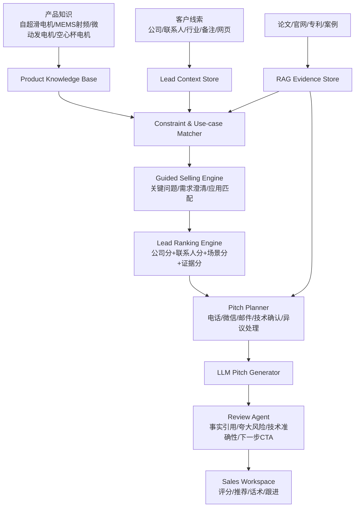
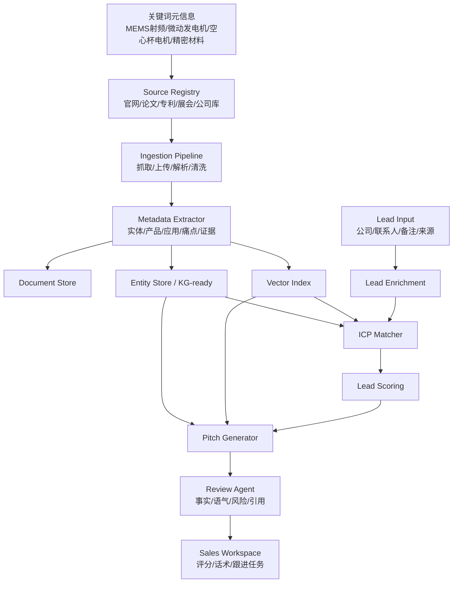

# B2B Marketing / Sales Agent 技术架构研究

更新时间：2026-07-13

## 研究问题

我们已经在清力 / FrictionX / 超滑项目中收集到大量关键词和元信息，例如：

- MEMS 射频开关
- 微动发电机
- 空心杯有刷电机
- 微纳加工平台
- 人形机器人微驱动
- 5G/5.5G/6G 基站
- 相控阵雷达
- 自供电传感器
- 低插损、高隔离度、微接触磨损、寿命测试、摩擦系数

下一步的核心问题不是“再收集关键词”，而是把这些关键词组织成可运行的 B2B marketing / sales agent 架构：

```text
关键词资产 -> 信息源发现 -> 线索抽取 -> 公司/联系人画像 -> ICP 匹配 -> 评分 -> 话术/触达建议 -> 人工审核 -> CRM 时间线
```

系统化文献知识库见：

```text
docs/literature-knowledge-base.md
```

## 阅读来源

### 1. HSTalks Business & Management Collection

链接：https://hstalks.com/business/

可核验信息：

- HSTalks Business & Management Collection 是商业与管理多媒体资源库。
- 其分类中包含 `Marketing & Sales`。
- Marketing & Sales 页面显示有 `B2B data-driven marketing`、`AI in Marketing` 系列、`Prompt engineering for AI in marketing and sales` 等条目。
- 页面提示 Guest 为 Limited Access，具体 talk 内容不一定可完整访问。

对我们的启发：

- B2B marketing agent 不应只是销售线索筛选，还要覆盖市场定位、内容生成、销售赋能和话术审核。
- AI 内容生成必须和“受众画像、渠道、语气、事实校验”绑定，不能孤立生成。

### 2. Frontiers: A review of AI-based business lead generation: Scrapus as a case study

链接：https://www.frontiersin.org/journals/artificial-intelligence/articles/10.3389/frai.2025.1606431/full

可核验信息：

- 论文发表于 Frontiers in Artificial Intelligence，AI in Business section。
- 论文提出 Scrapus，一个 AI-driven web prospecting platform。
- 架构包括：web crawling、information extraction、knowledge graph、ICP matching、LLM lead summaries。
- 论文明确指出 B2B lead generation 需要整合 web crawling、information extraction、data-driven analytics。
- Scrapus 使用 RL-guided crawler、Transformer-based NER、relation extraction、entity resolution、knowledge graph enrichment、semantic matching、LLM summarization。

对我们的启发：

- 我们应该把关键词元信息做成“可执行的发现策略”，而不是只存在 Markdown 文档里。
- 清力/超滑项目最适合用 Scrapus 类架构，但 P0 先做轻量版，不直接上 RL crawler。

## 论文和参考文献收集

### Lead Discovery / Web Prospecting

| 论文 | 价值 |
| --- | --- |
| Kaplan et al., 2025, Scrapus case study | 端到端 B2B lead generation 架构样板 |
| Ramakrishnan et al., 2006, Automatic sales lead generation from web data | 早期从 Web 数据中自动发现销售线索 |
| Rahman et al., 2012, Business Lead Generation for Online Real Estate Services | 多源数据整合和自动线索分类案例 |
| Chakrabarti et al., 1999, Focused crawling | 面向主题的聚焦爬虫基础 |
| Han et al., 2018, Focused crawling through reinforcement learning | 用强化学习做聚焦爬虫 |
| Kaleel and Sheen, 2023, Multi-armed bandits and adaptive epsilon decay | 用 bandit 改善爬虫探索/利用策略 |

### Lead Scoring / Sales Prediction

| 论文 | 价值 |
| --- | --- |
| Nygård and Mezei, 2020, Automating Lead scoring with ML | 将 lead scoring 看作购买概率预测 |
| González-Flores et al., 2025, B2B lead scoring model | 使用真实 CRM 数据和梯度提升模型做 B2B lead scoring |
| Rezazadeh, 2020, Generalized Flow for B2B Sales Predictive Modeling | 训练 pipeline + prediction pipeline 的销售预测工作流 |
| Sinha et al., 2022, Joint Dynamic Scoring of Account and Users | 同时评分 account 和个体用户，适合 B2B 长周期、多角色决策 |
| Espadinha-Cruz et al., 2021, Lead management optimization | 电信行业 lead management 数据挖掘 |
| Gouveia and Costa, 2022, Predicting lead conversion in SMEs | 中小企业 lead conversion 预测 |

### NLP / Entity / Knowledge Graph / RAG

| 论文 | 价值 |
| --- | --- |
| Lewis et al., 2020, Retrieval-Augmented Generation | RAG 基础架构：retriever + generator + non-parametric memory |
| Devlin et al., 2019, BERT | NER、分类、匹配的基础 transformer 模型 |
| Reimers and Gurevych, 2019, Sentence-BERT | 语义相似度和 ICP 匹配 |
| Barlaug and Gulla, 2021, Neural Networks for Entity Matching | 公司实体消歧、去重、合并 |
| Christen, 2012, Data matching | record linkage / entity resolution 基础 |
| Bizer et al., 2009, Linked Data | 外部知识库和 linked data 思路 |
| DBpedia / Wikidata / YAGO / Freebase references | 外部知识图谱补全 |

### B2B Marketing / AI Sales Funnel

| 论文 | 价值 |
| --- | --- |
| Järvinen and Taiminen, 2016, B2B content marketing automation | B2B 内容营销自动化基础 |
| Hofacker et al., 2020, Digital marketing and B2B relationships | B2B 数字营销关系视角 |
| Libai et al., 2020, AI and CRM | AI 用于客户关系管理时需要透明性 |
| Syam and Sharma, 2018, ML/AI in sales research and practice | AI sales 的理论背景 |
| Fehrenbach et al., 2025, AI applications in the B2B sales funnel | AI 在 B2B 销售漏斗中的应用 |
| Srinivas et al., 2025, Agentic Multimodal AI for Hyperpersonalized Advertising | 多模态、persona、RAG 和 agentic advertising 架构 |

## 现有 Agent 架构类型

## 补充检索：面向自超滑电机销售的论文缺口

前一轮 Scrapus / B2B marketing 文献主要覆盖：

- 从 Web 主动发现线索
- 信息抽取
- 知识图谱
- ICP 匹配
- LLM 摘要

但我们的产品目标更具体：

```text
自超滑电机产品推荐
+ 专业销售话术生成
+ 智能筛选潜在客户
```

因此需要再补三类研究：

1. **Guided Selling / Knowledge-based Recommender**
   解决“复杂技术产品如何根据客户应用场景推荐具体产品”。
2. **Conversational Recommender / Pre-sales Dialogue**
   解决“如何通过对话问出客户真实需求，并生成下一轮话术”。
3. **LLM Lead Scoring / Sales Ranking**
   解决“如何把结构化 CRM 字段和非结构化销售记录合并成潜客优先级”。

> 说明：Google Scholar 入口本身不稳定且经常限制自动访问，本轮采用 Google Scholar 风格的学术检索，并优先打开 arXiv、ACM、Frontiers 等可直接核验的一手页面。

## 新增论文线索

### A. 产品推荐 / Guided Selling / 复杂技术产品选型

| 论文/主题 | 核心价值 | 对自超滑电机 Agent 的启发 |
| --- | --- | --- |
| Jannach et al., 2021, A Survey on Conversational Recommender Systems | CRS 不只是给列表，而是通过多轮交互澄清偏好、解释推荐 | 我们的 Agent 应先问工况、部件、寿命、噪声、温升、空间尺寸，再推荐自超滑电机应用路径 |
| Gao et al., 2021, Advances and Challenges in Conversational Recommender Systems | 总结 CRS 五个挑战：偏好提问、多轮策略、对话理解、探索利用、评估 | 适合设计“销售问诊式话术”：先问关键问题，再给推荐 |
| Kostric et al., 2021, Usage-related Questions | 用“使用场景问题”替代直接问技术参数，降低用户回答门槛 | 面向客户不要先问摩擦系数，而应问“是否遇到寿命、噪声、发热、换电池维护问题” |
| Zuo et al., 2022, Hierarchical Conversational Preference Elicitation with Bandit Feedback | 在 key-term 和 item 推荐之间做探索/利用 | 我们可把 `人形机器人/空心杯电机/微动发电机/MEMS射频开关` 作为 key-term 层，把具体产品/应用作为 item 层 |
| Knowledge-based recommender / constraint-based recommender | 适合低频、复杂、规格约束强的产品 | 自超滑电机不是高频消费品，不能用普通协同过滤，应采用知识规则 + 约束匹配 |

### B. 专业销售话术 / Pre-sales Dialogue

| 论文/主题 | 核心价值 | 对自超滑电机 Agent 的启发 |
| --- | --- | --- |
| Liu et al., 2023, CRS and LLM in E-commerce Pre-sales Dialogue | CRS 擅长准确推荐，LLM 擅长自然语言回复，两者互补 | 我们应拆成“推荐引擎给结论 + LLM 生成销售话术”，不要让 LLM 单独决定产品匹配 |
| Liu, 2025, Optimizing Conversational Product Recommendation via RL | 强调推荐效果取决于“何时、如何推荐”，可用反馈优化 talk track | P0 不上 RL，但要保存话术反馈，P2 才能优化话术策略 |
| Guided Selling 研究线 | 强调需求理解、需求分析、产品推荐、推荐理由 | 我们的话术必须包含“为什么这个客户适合自超滑电机”的解释，而不是只生成销售文案 |

### C. 潜客筛选 / Lead Scoring

| 论文/主题 | 核心价值 | 对自超滑电机 Agent 的启发 |
| --- | --- | --- |
| Zhang et al., 2026, Rethinking Sales Lead Scoring with LLM-based Hierarchical Preference Ranking | LLM 可融合结构化 CRM 和非结构化互动记录；用层级偏好排序优化漏斗优先级 | 我们应从“单个分数”升级到“同一批客户的相对优先级排名” |
| Sinha et al., 2022, Joint Dynamic Scoring of Account and Users | B2B 需要同时评分 account 和个人用户 | 自超滑电机销售要同时判断公司适配度和联系人角色，如 CTO/研发/工艺/采购 |
| Rezazadeh, 2020, Generalized Flow for B2B Sales Predictive Modeling | 训练 pipeline 和 prediction pipeline 分离 | 未来有成交数据后，可把 P0 规则评分升级为训练/预测双流程 |

### D. Agent 通用架构

| 论文/主题 | 核心价值 | 对自超滑电机 Agent 的启发 |
| --- | --- | --- |
| Wang et al., 2023/2024, Survey on LLM-based Autonomous Agents | 常见 agent 架构包含 memory、planning、tool use、evaluation | 我们的销售 Agent 也应拆成记忆、计划、工具和审查，不要做单 prompt |
| Guo et al., 2024, LLM-based Multi-Agents survey | 多 Agent 适合复杂任务，但需要通信和治理 | P2 可拆 Research / Scoring / Product Recommendation / Pitch / Review Agents |
| Tang et al., 2025, LLM-driven Industry Agents survey | 行业 Agent 需要真实性、安全性、行业特定评估 | 自超滑电机 Agent 必须有事实引用、禁用夸大承诺、保留人工审核 |

## 修正后的功能架构

根据补充论文，原来的 “RAG Sales Copilot” 需要扩展成：

```text
RAG + Guided Selling + Conversational Recommendation + Lead Ranking + Review Agent
```

### 新架构总览



### 产品推荐层

自超滑电机推荐不应直接由 LLM 生成，而应由 `Constraint & Use-case Matcher` 给出可解释结论。

输入：

```text
客户行业
应用部件
痛点：磨损/噪声/温升/寿命/能耗/接触失效
工况：转速/负载/空间/频率/维护周期
证据需求：摩擦系数/寿命测试/温升/循环次数
```

输出：

```text
推荐应用方向：空心杯电机 / 微动发电机 / MEMS射频开关 / 微纳平台
匹配原因
缺失信息
下一步应问的问题
推荐话术素材
```

### Guided Selling 问诊层

对客户不要先问技术术语，而要问使用场景问题：

| 场景 | 问诊问题 |
| --- | --- |
| 空心杯电机 | 当前微型电机主要失效来自电刷磨损、噪声、温升还是寿命不足？ |
| 人形机器人 | 灵巧手或关节模组的高频动作是否带来磨损和维护频率问题？ |
| 微动发电机 | 传感节点是否存在换电池维护成本高、布线困难或低功耗供电难题？ |
| MEMS 射频开关 | 高频开关是否关注低插损、高隔离和长期循环可靠性？ |

### Lead Ranking 层

从单条评分升级为批量排序：

```text
LeadScore = CompanyFit + ApplicationFit + PainSeverity + ContactPower + EvidenceStrength + Timing - Risk
```

新增两个 B2B 维度：

- `AccountScore`：公司是否属于目标产业链。
- `ContactScore`：联系人是否接近研发、工艺、采购、CTO 或实验室负责人。

### Pitch Generation 层

采用“推荐结论 + 证据引用 + 渠道风格”的生成模式：

```text
Product Matcher 输出结构化推荐
RAG Retriever 输出证据
Pitch Planner 选择话术结构
LLM 生成自然语言
Review Agent 审查
```

禁止：

- LLM 直接承诺“提升多少寿命/降低多少摩擦”。
- 没有证据时输出具体性能数字。
- 把内部推断写成官网事实。

## 更新后的实现策略

### P0.5：补产品推荐与问诊字段

新增字段：

```text
applicationTrack: 空心杯电机 / 微动发电机 / MEMS射频开关 / 微纳加工平台
useCaseQuestion: 面向客户的场景问诊问题
technicalConstraint: 转速 / 负载 / 接触循环 / 温升 / 空间尺寸
painSeverity: 低 / 中 / 高
missingInfo: 缺失参数
recommendationReason: 推荐理由
evidenceRequired: 需要的测试数据
```

### P1：RAG + Guided Selling

做：

- 把 FrictionX 官网、论文、专利、产品页入库。
- 给每个 chunk 打 metadata。
- 产品推荐先由规则/约束引擎输出。
- LLM 只负责解释和生成话术。

### P2：Lead Ranking + Conversation Feedback

做：

- 批量线索排序。
- 保存销售反馈：有效/无效/需技术支持/已约样品测试。
- 用反馈改进权重。

### P3：多 Agent Campaign

拆成：

- Research Agent
- Product Recommendation Agent
- Lead Ranking Agent
- Pitch Agent
- Review Agent
- CRM Task Agent

## 修正后的结论

之前的架构研究主要回答了“如何发现线索”，但没有充分回答：

- 如何推荐自超滑电机产品。
- 如何生成技术可信的话术。
- 如何筛选真正适合联合验证或样品测试的客户。

补充检索后，最适合我们的架构应是：

```text
Knowledge-based Guided Selling
+ RAG Evidence Store
+ Conversational Recommender
+ LLM Lead Ranking
+ Review Agent
```

也就是说，我们的 Agent 不是单纯营销文案生成器，而是一个“技术型销售顾问系统”。

第一步应该先把当前 demo 从：

```text
线索评分 + 话术生成
```

升级为：

```text
线索评分 + 产品应用推荐 + 场景问诊 + 证据引用 + 话术生成 + Review
```


### 架构 A：规则 + CRM 数据评分架构

```text
Lead/Company 数据
-> 特征工程
-> 规则评分 / ML 评分
-> A/B/C/D 分级
-> 销售动作建议
```

适合：

- 已经有 CRM 历史数据。
- 目标是快速排序线索。
- 不需要主动发现新客户。

优点：

- 简单、可解释、上线快。
- 对 P0 很友好。

缺点：

- 只能处理已有线索。
- 不能自动从外部发现新客户。

我们当前 demo 基本属于这一类。

### 架构 B：Scrapus 式 Open-Web Prospecting 架构

```text
Seed URLs / 行业关键词
-> Focused Crawler
-> 页面清洗
-> NER / Relation Extraction
-> Entity Resolution
-> Knowledge Graph
-> ICP Matching
-> Lead Scoring
-> LLM Summary
-> Human Review
-> CRM
```

适合：

- 需要主动找新客户。
- 行业关键词清晰。
- 可接受后台任务和异步计算。

优点：

- 能把关键词资产转化为外部线索发现能力。
- 适合清力/超滑这种技术型 B2B 拓客。

缺点：

- 工程复杂。
- 要处理网页质量、重复公司、事实校验、抓取合规。

### 架构 C：RAG-first Sales Copilot 架构

```text
产品资料 / 论文 / 专利 / 官网 / 案例
-> 文档解析
-> Chunking
-> Embedding
-> Vector DB
-> Hybrid Retrieval
-> LLM 生成
-> Citation / Fact Check
-> 销售话术 / 邮件 / 拜访提纲
```

适合：

- 线索可以人工导入或来自已有名单。
- 核心难点是“专业话术”和“技术解释”。
- 产品技术壁垒高，需要事实引用。

优点：

- 最适合当前清力/超滑项目。
- 能显著提升话术专业度。
- 和我们已做的知识库模块最顺。

缺点：

- 不自动找客户。
- 检索质量决定生成质量。

### 架构 D：Knowledge Graph + Vector Hybrid 架构

```text
结构化实体：Company / Product / Application / Pain / Evidence / Contact
非结构化文档：官网 / 新闻 / 专利 / 论文 / 产品手册
-> KG 存实体和关系
-> Vector DB 存语义片段
-> Graph Query + Vector Retrieval
-> ICP Matching / 话术生成 / 证据引用
```

适合：

- B2B 决策链复杂。
- 一个公司有多个产品、应用场景和决策角色。
- 需要可解释推荐。

优点：

- 能把“关键词元信息”变成可计算关系。
- 对清力/超滑四条主线非常合适。

缺点：

- P0 直接上完整 KG 成本高。
- 需要实体抽取和实体消歧。

### 架构 E：Multi-Agent Campaign 架构

```text
Research Agent
-> Enrichment Agent
-> Scoring Agent
-> Persona Agent
-> Pitch Agent
-> Review Agent
-> CRM/Task Agent
```

适合：

- 多渠道触达。
- 多种客户 persona。
- 需要生成邮件、微信、电话、展会、拜访多种内容。

优点：

- 任务边界清晰。
- 易于扩展。

缺点：

- 如果没有 review gate，幻觉和误触达风险高。
- 编排、日志、权限和人工确认必须做好。

## 推荐 RAG 架构

我们应该采用 “RAG + KG-ready + Review Gate” 架构。

### 总体结构



### RAG 数据层

| 数据层 | 内容 |
| --- | --- |
| Source Registry | 记录来源 URL、类型、抓取时间、可信等级 |
| Raw Document Store | 原始网页、PDF、论文、产品页、专利摘要 |
| Chunk Store | 切片文本、chunk id、source id、章节、页码 |
| Vector Index | 语义检索 |
| Metadata Store | 关键词、实体、行业主线、应用部件、痛点、证据类型 |
| Entity Store | 公司、产品、应用、联系人、事件 |
| Review Log | 每条生成内容引用了哪些证据，是否通过审核 |

### Metadata Schema

```text
sourceType: official_site / paper / patent / news / exhibition / company_db / user_note
industryTrack: MEMS射频开关 / 微动发电机 / 空心杯电机 / 精密材料
applicationPart: MEMS微接触 / 微动结构 / 电刷换向器 / 涂层 / 微纳加工
painPoint: 磨损 / 发热 / 噪声 / 能耗 / 寿命 / 接触失效 / 低插损 / 高隔离
evidenceType: 官网事实 / 论文 / 专利 / 测试数据 / 客户案例 / 销售假设
confidence: verified / inferred / user_provided / unverified
reviewStatus: pending / approved / rejected / needs_source
```

## 可行方案

### 方案 1：轻量 RAG Sales Copilot

范围：

- 用户导入线索。
- 系统基于清力官网、产品资料、关键词库做检索。
- 生成线索评分和销售话术。
- Review Agent 检查事实引用和语气。

技术：

- Next.js 当前项目继续扩展。
- 文件/SQLite/Postgres 存文档和元数据。
- pgvector 或轻量向量库。
- Rule scoring + LLM explanation。

优点：

- 最快落地。
- 和现有 demo 接续最顺。
- 适合 1-2 周内出可演示版本。

缺点：

- 不自动发现新客户。

建议：

- 作为 P0/P1 首选。

### 方案 2：Open-Web Prospecting Pipeline

范围：

- 输入关键词和 seed URLs。
- 后台抓取官网、新闻、展会、目录页。
- 抽取公司、产品、应用场景、联系方式。
- 自动生成候选线索。

技术：

- Crawler worker
- HTML cleaner
- NER / LLM extraction
- Entity resolution
- Lead scoring
- Review queue

优点：

- 真正把关键词变成拓客线索。
- 对清力超滑项目有明显增量价值。

缺点：

- 需要合规和反爬边界。
- 需要异步任务、去重、事实校验。

建议：

- 作为 P1/P2。
- P1 可先做“半自动抓取”：用户输入 URL，系统抽取公司和线索。

### 方案 3：KG + Vector Hybrid Intelligence

范围：

- 维护公司、产品、应用、痛点、证据、联系人之间的关系。
- 支持“找哪些客户适合 MEMS 射频开关？”这种图查询。
- 支持“这个客户为什么匹配？”的证据解释。

技术：

- Postgres relational schema 起步。
- 后续 Neo4j / graph extension。
- Vector retrieval + graph relation retrieval。

优点：

- 最适合长期沉淀行业知识。
- 可解释性强。

缺点：

- 初期开发成本更高。

建议：

- P1 先做 KG-ready schema。
- P2 再引入真正图数据库。

### 方案 4：Multi-Agent Campaign Studio

范围：

- Research Agent 找资料。
- Scoring Agent 评分。
- Persona Agent 判断决策人角色。
- Pitch Agent 生成多渠道内容。
- Review Agent 审查。
- Task Agent 创建跟进任务。

优点：

- 适合后续规模化营销。
- 可支持邮件、微信、电话、展会、拜访等多触点。

缺点：

- 风险高，必须有人审。
- P0 过早做会拖慢产品。

建议：

- 作为 P2/P3。

## 推荐路线

### P0.5：把当前 demo 升级为 RAG-ready

做：

- Source Registry
- Document / Chunk / Metadata
- ReviewStatus
- 引用来源展示
- 清力官网资料入库

不做：

- 自动爬全网
- 图数据库
- 自动群发

### P1：半自动线索发现

做：

- 用户输入 URL / 公司名 / 展会名单。
- 系统抽取公司、产品、应用、痛点。
- 生成候选线索。
- 人工确认后进入 CRM。

### P2：聚焦爬虫 + KG-ready

做：

- 按四条主线配置 seed URLs。
- 异步抓取。
- 线索去重。
- 建立 Company-Product-Application-Pain 关系。

### P3：Multi-Agent Campaign

做：

- 多渠道触达计划。
- Persona-based 话术。
- A/B 测试。
- 销售转化回流训练评分。

## 当前建议

对我们现在的项目，最稳的方案是：

```text
方案 1 作为主线：轻量 RAG Sales Copilot
+ 方案 3 的 KG-ready schema
+ 方案 2 的半自动 URL 抽取能力
```

不要马上做完整 Scrapus。我们先把已有关键词资产变成“可检索、可引用、可评分、可审查”的 RAG 架构，然后再逐步扩展到主动拓客。

## Sources

- HSTalks Business & Management Collection: https://hstalks.com/business/
- HSTalks Marketing & Sales category: https://hstalks.com/category/769/marketing-sales/?business=
- Kaplan et al. 2025, Scrapus case study: https://www.frontiersin.org/journals/artificial-intelligence/articles/10.3389/frai.2025.1606431/full
- Lewis et al. 2020, Retrieval-Augmented Generation: https://proceedings.neurips.cc/paper/2020/file/6b493230205f780e1bc26945df7481e5-Paper.pdf
- Rezazadeh 2020, B2B sales predictive modeling: https://arxiv.org/abs/2002.01441
- Sinha et al. 2022, Joint dynamic scoring of account and users: https://arxiv.org/abs/2209.14250
- Srinivas et al. 2025, Agentic multimodal AI for advertising: https://arxiv.org/abs/2504.00338
- Jannach et al. 2021, A Survey on Conversational Recommender Systems: https://arxiv.org/abs/2004.00646
- Gao et al. 2021, Advances and Challenges in Conversational Recommender Systems: https://arxiv.org/abs/2101.09459
- Kostric et al. 2021, Usage-related Questions: https://arxiv.org/abs/2109.05454
- Zuo et al. 2022, Hierarchical Conversational Preference Elicitation with Bandit Feedback: https://arxiv.org/abs/2203.03922
- Liu et al. 2023, CRS and LLM in E-commerce Pre-sales Dialogue: https://arxiv.org/abs/2308.06259
- Liu 2025, Optimizing Conversational Product Recommendation via RL: https://arxiv.org/abs/2503.02474
- Zhang et al. 2026, Rethinking Sales Lead Scoring with LLM-based Hierarchical Preference Ranking: https://arxiv.org/abs/2606.04387
- Wang et al. 2023, A Survey on LLM-based Autonomous Agents: https://arxiv.org/abs/2308.11432
- Guo et al. 2024, Large Language Model based Multi-Agents survey: https://arxiv.org/abs/2402.01680
- Tang et al. 2025, LLM-driven Industry Agents survey: https://arxiv.org/abs/2505.13061
