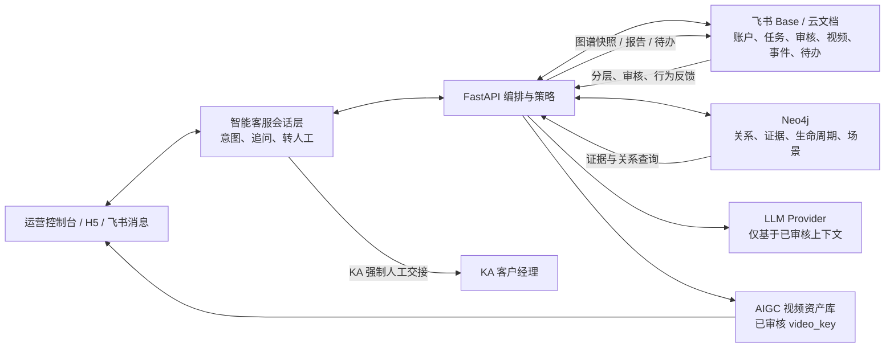

# PRD：电机销售拓客 AIGC 销售 Agent

更新时间：2026-07-14

## 1. 产品目标

开发一个能辅助电机销售团队拓客、自动生成专业销售话术、智能筛选潜在客户的 AIGC 销售 Agent。

当前阶段不做泛 CRM、不做通用 AI 工作流平台，而是聚焦一个可演示、可验证、能服务真实销售流程的闭环：

```text
导入潜在线索 -> AI 补全客户画像 -> 智能评分筛选 -> 匹配电机产品/应用场景 -> 生成专业销售话术 -> 形成跟进任务和记录
```

### 1.1 当前重点业务：自超滑空心杯电机销售

产品首要聚焦 Friction X 自超滑有刷/无刷空心杯电机平台，以及“电机 + 齿轮箱 + FOC 控制器”的整体解决方案。销售 Agent 的首要工作是辅助该产品完成潜客筛选、应用匹配、问诊式销售和专业话术生成。

优先客户场景：

- 人形机器人与灵巧手
- 人形机器人与灵巧手
- 高端医疗设备
- 消费无人机
- 手持云台
- 激光雷达

宣传主线同样限定为“自超滑空心杯电机”，不以泛工业电机作为核心卖点。前端产品目录只能展示《自超滑技术与空心杯电机》（2026-07-13）已明确披露的产品平台与整体解决方案；资料未披露的参数必须标记为“按项目选型确认”。

资料中的“实测寿命最高 8000h”与“目标寿命 20000h”不得被客服或销售话术改写为所有型号、所有工况下的承诺。

注意：清力技术有限公司主体信息目前未完成公开核验，不能写入对外材料。内部研究备忘录见：

```text
docs/qingli-company-research.md
```

销售 Agent 后续需要支持围绕“电刷/换向器磨损、寿命、噪声、发热、能耗、精密传动可靠性”的拓客和话术生成。

所有对外话术、性能数字、客户案例和公司主体事实必须先通过 Review Agent，再由人工确认。

## 2. 用户画像

### 2.1 一线销售

需求：

- 快速判断一个客户值不值得跟进。
- 知道应该主推哪类电机产品。
- 自动生成专业、可信、不空泛的电话/微信/邮件话术。
- 记录跟进动作，知道下一步该做什么。

### 2.2 销售主管

需求：

- 配置目标行业、产品策略、评分规则。
- 查看线索池质量和销售跟进进度。
- 统一团队话术口径。
- 沉淀优秀销售 SOP 和行业案例。

### 2.3 售前/技术支持

需求：

- 维护电机产品知识库。
- 确保销售话术中涉及的技术参数准确。
- 为复杂客户提供产品匹配建议。

### 2.4 客户受众与横向分层

系统必须在评分之前完成账户分层；层级由确定性业务规则、人工校正和证据共同决定，不可只根据员工人数猜测。

| 层级 | 定义 | 客服与触达策略 | 人工策略 |
| --- | --- | --- | --- |
| KA | 全国布局、集团化或战略性 B 端大客户 | 仅接待、收集需求、提供已审核资料/视频卡与预约入口；不得自动销售或报价 | `HUMAN_REQUIRED`：立即创建客户经理待办并进入人工沟通 |
| LA | 本地 B 端客户 | 可进行需求澄清、技术交流预约、已审核视频推荐 | `HUMAN_APPROVAL`：首次外发、报价、性能承诺须人工确认 |
| SMB | 小型客户或标准化需求客户 | 在授权和频控下进行 FAQ、内容培育、视频卡和预约 CTA | 高意向、复杂技术/价格问题或明确预约时转人工 |

所有账户至少维护：`account_tier`、`tier_reason`、`coverage_scope`、`owner`、`routing_policy`、`human_handoff_at` 与最近一次人工校正记录。

## 3. 核心场景

### 场景 A：导入公司名单后智能筛选

销售上传一批潜在客户名单，系统自动分析行业、地区、规模、应用场景、采购可能性，并给出评分和优先级。

输出：

- A/B/C/D 线索等级
- 推荐跟进理由
- 可能需求场景
- 推荐电机产品类型
- 风险或不匹配原因

### 场景 B：为单个客户生成专业话术

销售打开某个客户详情，选择渠道：

- 电话开场白
- 微信首次触达
- 邮件开发信
- 展会后跟进
- 报价后催单
- 价格异议处理
- 技术参数确认

系统结合客户画像、产品知识库、销售 SOP 生成话术。

### 场景 C：根据电机应用场景匹配客户

销售输入目标产品或应用，例如：

- 自超滑有刷空心杯电机平台
- 自超滑无刷空心杯电机平台
- 自超滑空心杯电机整体解决方案
- 人形机器人、高端医疗设备、消费无人机、手持云台、激光雷达

系统从线索池中筛选更可能匹配的客户，并生成推荐理由。

### 场景 D：沉淀销售知识库

销售主管或技术支持上传：

- 产品手册
- 选型资料
- 行业案例
- 竞品对比
- 常见异议
- 报价策略
- 售后 FAQ

Agent 生成话术和评分时必须引用这些知识。

## 4. P0 功能范围

### 4.1 线索管理

必须支持：

- 新建线索
- 批量导入 CSV
- 线索列表
- 线索详情
- 状态流转：新线索、待跟进、已联系、有意向、无效、暂缓
- 标签：行业、产品兴趣、优先级、来源

P0 字段：

- 公司名称
- 行业
- 地区
- 公司规模
- 联系人
- 职位
- 联系方式
- 来源
- 备注

### 4.2 客户画像补全

P0 先支持“半自动补全”：

- 用户输入已知信息。
- Agent 根据已有字段、备注、知识库和人工输入推断画像。
- 联网/外部数据源接入放到 P1。

输出字段：

- 可能应用场景
- 采购可能性
- 决策链角色判断
- 主要痛点
- 推荐跟进方向

### 4.3 潜客评分

采用“规则分 + AI 判断分 + 解释”的组合。

P0 评分维度：

| 维度 | 分值 | 说明 |
| --- | ---: | --- |
| 行业匹配 | 0-25 | 是否属于电机高需求行业 |
| 应用场景匹配 | 0-25 | 是否存在明确电机使用场景 |
| 公司规模/采购能力 | 0-15 | 是否有稳定采购能力 |
| 决策人可触达性 | 0-15 | 联系人职位和可触达程度 |
| 需求紧迫度 | 0-10 | 是否有近期采购、替换、扩产线索 |
| 风险扣分 | -20-0 | 信息缺失、贸易商低质、价格极敏感等 |

评分输出：

- 总分
- 等级：A/B/C/D
- 分项得分
- 评分理由
- 建议动作

### 4.3.1 自超滑电机产品推荐

新增 P0.5 功能：在潜客评分之后，不直接生成泛销售话术，而是先生成“产品应用推荐”。

推荐对象：

- 自超滑有刷空心杯电机平台
- 自超滑无刷空心杯电机平台
- 电机 + 齿轮箱 + FOC 控制器整体解决方案

推荐逻辑：

```text
客户行业 + 应用部件 + 摩擦痛点 + 工况约束 + 证据需求
-> 应用方向推荐
-> 缺失问题
-> 推荐理由
-> 下一步问诊问题
```

每次推荐必须输出：

- 推荐应用方向
- 匹配理由
- 缺失信息
- 场景问诊问题
- 需要的证据或测试数据
- 是否适合样品测试/联合验证

### 4.4 专业销售话术生成

P0 支持 6 类话术：

1. 电话开场白
2. 微信首次触达
3. 邮件开发信
4. 报价后跟进
5. 价格异议处理
6. 技术参数确认

每条话术必须包含：

- 客户背景假设
- 推荐产品或应用场景
- 核心利益点
- 低打扰式提问
- 下一步 CTA
- 可编辑正文

补充要求：

- 话术必须引用产品推荐结论和 RAG 证据。
- 没有证据时不能承诺具体性能数字。
- 对自超滑电机客户，优先采用“问诊式销售”结构，先确认寿命、噪声、温升、磨损、维护成本、接触失效等问题。

### 4.5 产品知识库与事实治理

P0 支持：

- 上传文本/Markdown/PDF
- 基础检索
- 生成话术时引用知识片段

产品目录不是自由录入表：产品新增、产品参数变更和性能数字发布必须由产品资料审核流程完成。销售话术资料可新增，但不得反向修改产品事实。

知识类型：

- 产品参数
- 应用行业
- 选型要点
- 常见异议
- 成功案例

### 4.6 一体化前后端演示

必须实现前后端一体，而不是后端做完没有可演示界面。

P0 演示闭环：

1. 在前端导入或新建线索。
2. 点击“AI 评分”。
3. 页面展示分项评分和推荐理由。
4. 点击“生成话术”。
5. 页面展示多渠道销售话术。
6. 保存为跟进记录。

### 4.7 智能客服、视频与反馈闭环

智能客服是对客会话服务，不等同于“话术生成器”。它必须承接 H5、飞书消息或视频卡进入的客户问题，并完成：

- 意图识别、澄清提问、需求字段采集和会话摘要；
- 仅基于已审核产品事实和 Neo4j 证据回答；未披露参数统一转为项目选型确认；
- 依据 `video_key` 匹配已审核 AIGC 视频资产，禁止模型自由生成视频 URL；
- 将播放、完播、点击、停留、CTA、提问深度、预约和人工接管事件写入飞书行为事件表；
- 由 FastAPI 将已确认反馈同步至 Neo4j，更新兴趣、场景、生命周期与下一步动作。

KA、LA、SMB 的客服权限必须执行第 2.4 节的分层策略；“需要人工”专门指 KA 的强制人工沟通，不得被误用为所有客户的默认路径。

## 5. 非目标

P0 不做：

- 完整 CRM 替代
- 自动群发邮件/微信
- 外部企业数据抓取
- 完整工作流画布
- 多租户复杂权限
- 自动成交预测
- 和 ERP/财务系统深度集成

## 6. 信息架构

主导航：

- Dashboard
- Leads
- Companies
- Products
- Knowledge Base
- Agent Studio
- Follow-ups
- Settings

P0 页面：

- Leads 列表
- Lead 详情
- 产品知识库
- Agent 测试台
- 评分规则设置

## 7. 技术架构

目标架构采用“前端控制台 + FastAPI 编排 + 飞书控制面 + Neo4j 图谱 + LLM Provider”的解耦模式。当前 Next.js 前端可作为过渡控制台；生产前端可迁移到 Vue，但两者均不得直接访问飞书密钥、Neo4j 或模型 Provider。



飞书 Base 是贯穿式运营控制面与反馈总线，而非最终结果落点。Neo4j 负责图关系查询；图谱图片由 FastAPI 根据飞书指定的账户、关系深度、时间范围查询 Neo4j 后生成 SVG/PNG/Mermaid，并回写飞书云文档或附件。

后端模块：

```text
app/api/leads
app/api/products
app/api/knowledge
app/api/agent/score-lead
app/api/agent/generate-pitch
app/api/follow-ups

src/server/agents
src/server/services
src/server/repositories
src/server/llm
src/server/scoring
src/server/rag
```

前端模块：

```text
src/app/leads
src/app/leads/[id]
src/app/products
src/app/knowledge
src/app/agent
src/components/leads
src/components/agent
src/components/scoring
```

## 8. 数据模型草案

### Lead

- id
- companyName
- industry
- region
- companySize
- contactName
- contactTitle
- contactMethod
- source
- status
- tags
- accountTier (KA / LA / SMB)
- tierReason
- coverageScope
- owner
- routingPolicy
- humanHandoffAt
- notes
- createdAt
- updatedAt

### LeadScore

- id
- leadId
- totalScore
- grade
- industryScore
- useCaseScore
- companyFitScore
- contactScore
- urgencyScore
- riskPenalty
- reasons
- recommendedAction
- modelVersion
- createdAt

### Product

- id
- name
- model
- category
- powerRange
- voltage
- speed
- torque
- protectionLevel
- useCases
- sellingPoints
- notes

### KnowledgeDocument

- id
- title
- type
- content
- sourceFile
- createdAt
- updatedAt

### GeneratedPitch

- id
- leadId
- productId
- channel
- scenario
- content
- rationale
- citations
- createdAt

### FollowUp

- id
- leadId
- pitchId
- type
- content
- nextActionAt
- status
- createdAt

## 9. 验收标准

P0 验收：

- 能录入或导入至少 20 条线索。
- 能对单条线索生成可解释评分。
- 能基于评分和产品知识生成至少 6 类话术。
- 能保存生成结果到线索时间线。
- 前端页面能完整演示上述流程。
- 后端 API 有清晰边界，可被前端和未来机器人复用。

## 10. 成功指标

早期指标：

- 单条线索分析时间 < 30 秒。
- 销售话术人工可用率 > 60%。
- 销售对 A/B/C/D 评分认可度 > 70%。
- 单个销售每天节省线索初筛时间 > 30 分钟。

中期指标：

- A 级线索转有效沟通率提升。
- 报价前沟通轮次减少。
- 新销售上手周期缩短。
- 行业案例和话术资产沉淀数量增长。

## 11. v4.1 验收补充：分层、客服与反馈

- 每个有效账户都有 KA/LA/SMB 分层、理由、负责人和路由策略；人工可校正且可审计。
- KA 新线索创建后 5 分钟内生成客户经理待办；系统不得向 KA 自动发送营销、报价或性能承诺。
- LA 首次对客触达、报价和性能承诺必须经过人工审核；SMB 自动化仅在授权和频控策略下运行。
- 智能客服可以接收问题、记录会话、调用已审核事实、推荐已审核视频，并在不确定/高风险场景转人工。
- 视频资产、播放行为和 CTA 事件在飞书 Base 可追溯，并能更新 Neo4j 的关系或标签。
- 飞书可选择图谱范围并触发 Neo4j 图谱快照生成；生成结果回写飞书文档或附件。
