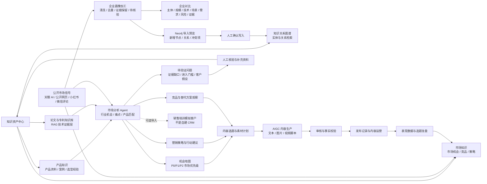
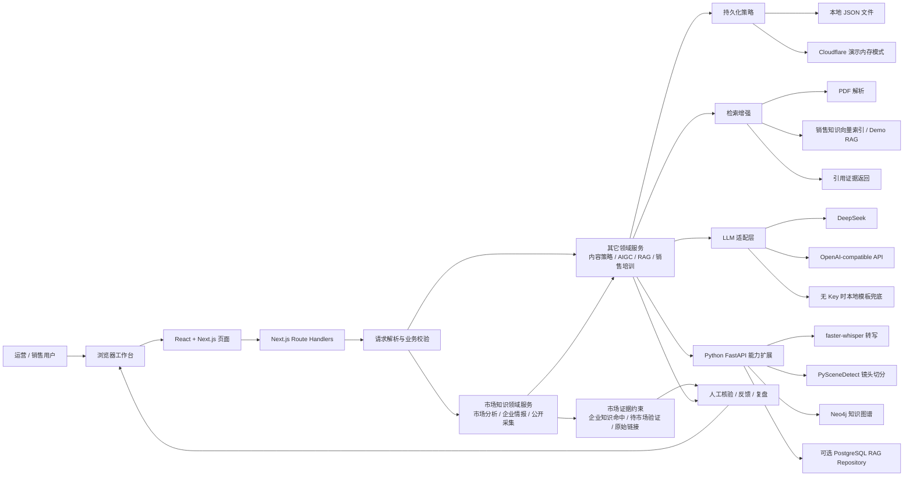
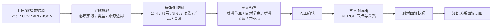
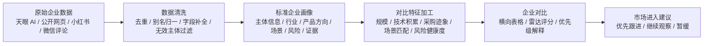

# 运营自动化企业级 Agent 项目逻辑图

更新时间：2026-07-23

## 项目目录

```text
.
├── README.md
├── package.json
├── next.config.mjs
├── open-next.config.ts
├── wrangler.jsonc
├── src
│   ├── app
│   │   ├── page.tsx
│   │   ├── layout.tsx
│   │   ├── globals.css
│   │   ├── agent
│   │   ├── aigc
│   │   ├── api
│   │   ├── content
│   │   ├── graph
│   │   ├── knowledge
│   │   ├── leads
│   │   └── marketing
│   ├── components
│   │   ├── agent
│   │   ├── content
│   │   ├── graph
│   │   ├── home
│   │   ├── layout
│   │   ├── leads
│   │   ├── marketing
│   │   ├── scoring
│   │   └── system
│   ├── mcp
│   │   ├── contentOperationsServer.ts
│   │   └── runContentOperationsMcp.ts
│   └── server
│       ├── agents
│       ├── ai
│       ├── aigc
│       ├── analysis
│       ├── content-operations
│       ├── contentStrategy
│       ├── data
│       ├── knowledge
│       ├── learning
│       ├── llm
│       ├── persuasion
│       ├── rag
│       ├── repositories
│       ├── scoring
│       ├── segmentation
│       ├── sources
│       └── videoAnalysis
├── agent_root
│   ├── Dockerfile
│   ├── docker-compose.yml
│   ├── requirements.txt
│   ├── src
│   │   ├── main.py
│   │   ├── api
│   │   ├── core
│   │   ├── processors
│   │   ├── rag
│   │   ├── services
│   │   └── tasks
│   ├── scripts
│   └── tests
├── data
│   ├── app-data.json
│   ├── content-operations.json
│   ├── rag-demo-data.json
│   ├── rag-demo-files
│   ├── neo4j-graph-snapshot.json
│   └── xiaohongshu-signals.json
├── docs
├── public
├── test
├── poster
├── roadshow-publish
└── 内容运营agent思考
```

## 项目逻辑图

这张图按当前已实现的产品重心绘制：主线是“知识资产中心 / 市场知识”，不是自建 CRM。`leads` 与跟进记录更像早期销售演示能力，当前不应作为核心闭环表达。



## 工程实现图

这张图不按文件夹平铺，而按“页面实际内容 -> API 动作 -> 后端生成的数据产物”来读。

```mermaid
flowchart TB
  subgraph Page["页面层：用户实际看到的模块"]
    MarketingPage["市场知识入口<br/>/marketing<br/>src/app/marketing/page.tsx"]
    Workbench["MarketAnalysisWorkbench<br/>市场策略总览工作台"]
    TianyanUI["企业市场情报<br/>搜索企业 / 主体核验 / 风险总览"]
    PublicResearchUI["公开信息采集<br/>竞品动态 / 潜在客户"]
    ReportUI["最新市场报告<br/>摘要 / 知识引用 / 生成时间"]
    SignalUI["公开需求与痛点信号<br/>小红书账号 / 笔记 / 意向 / 推荐动作"]
    OpportunityUI["市场机会与进入路径<br/>P0-P2 / 目标客户 / 痛点 / 产品匹配"]
    CompetitorUI["竞品与替代方案<br/>市场信号 / 对我方含义 / 证据标签"]
    StrategyUI["30 天行动建议<br/>推荐动作 / 待确认问题"]
    CompanyPipelineUI["企业数据加工与对比<br/>画像清洗 / 企业对比 / Neo4j 导入预览"]
  end

  MarketingPage --> Workbench
  Workbench --> TianyanUI
  Workbench --> PublicResearchUI
  Workbench --> ReportUI
  Workbench --> SignalUI
  Workbench --> OpportunityUI
  Workbench --> CompetitorUI
  Workbench --> StrategyUI
  Workbench --> CompanyPipelineUI

  subgraph Api["API 层：页面按钮触发的动作"]
    AnalyzeApi["运行市场分析<br/>POST /api/agent/analyze-market"]
    TianyanApi["搜索/读取企业情报<br/>POST /api/market-intelligence/tianyan"]
    CrawlApi["公开网页采集<br/>POST /api/market-research/crawl"]
    LearningApi["可选：导入模拟客户<br/>POST /api/learning-conversations"]
    CompanyProfilesApi["企业画像<br/>GET/POST /api/market-intelligence/company-profiles"]
    CompanyComparisonApi["企业对比<br/>POST /api/market-intelligence/company-comparison"]
    GraphPreviewApi["图谱导入预览<br/>POST /api/graph/import/preview"]
    GraphConfirmApi["确认写入图谱<br/>POST /api/graph/import/confirm"]
  end

  Workbench --> AnalyzeApi
  TianyanUI --> TianyanApi
  PublicResearchUI --> CrawlApi
  TianyanUI -.不是 CRM，只做培训素材.-> LearningApi
  CompanyPipelineUI --> CompanyProfilesApi
  CompanyPipelineUI --> CompanyComparisonApi
  CompanyPipelineUI --> GraphPreviewApi
  CompanyPipelineUI --> GraphConfirmApi

  subgraph Service["服务层：业务规则和外部来源适配"]
    MarketAgent["市场分析 Agent<br/>src/server/agents/marketAnalysisAgent.ts<br/>市场蓝图 / 优先级 / 证据标签"]
    ProductRepo["产品资料<br/>src/server/repositories/products.ts"]
    KnowledgeRepo["企业知识<br/>src/server/repositories/knowledge.ts"]
    MarketRepo["市场报告仓储<br/>src/server/repositories/marketReports.ts"]
    XiaohongshuSource["小红书公开信号<br/>src/server/sources/xiaohongshu.ts"]
    TianyanSource["天眼 AI 适配<br/>src/server/sources/tianyanAi.ts"]
    PythonMarketResearch["Python 公开采集服务<br/>agent_root /api/market-research/crawl"]
    CompanyProfileService["企业画像清洗<br/>src/server/analysis/companyProfile.ts"]
    CompanyCompareService["企业对比评分<br/>src/server/analysis/companyComparison.ts"]
    CompanyGraphImporter["企业图谱导入器<br/>agent_root/src/services/company_graph_importer.py"]
  end

  AnalyzeApi --> MarketAgent
  MarketAgent --> ProductRepo
  MarketAgent --> KnowledgeRepo
  MarketAgent --> XiaohongshuSource
  MarketAgent --> MarketRepo
  TianyanApi --> TianyanSource
  CrawlApi --> PythonMarketResearch
  CompanyProfilesApi --> CompanyProfileService
  CompanyComparisonApi --> CompanyCompareService
  GraphPreviewApi --> CompanyGraphImporter
  GraphConfirmApi --> CompanyGraphImporter

  subgraph Data["数据产物层：最终沉淀什么"]
    AppData["data/app-data.json<br/>产品 / 知识 / 市场报告 / 模拟客户"]
    XhsData["data/xiaohongshu-signals.json<br/>公开需求信号演示数据"]
    ReportData["MarketAnalysisReport<br/>segments / competitorWatch / actions / openQuestions"]
    ReviewState["待人工核验状态<br/>不能把推断当事实"]
    CompanyProfileData["CompanyProfile<br/>统一企业画像 / 证据链接 / 核验状态"]
    GraphPreviewData["GraphImportPreview<br/>节点 / 关系 / 冲突 / 汇总"]
  end

  ProductRepo --> AppData
  KnowledgeRepo --> AppData
  MarketRepo --> AppData
  XiaohongshuSource --> XhsData
  MarketRepo --> ReportData
  TianyanSource --> ReviewState
  PythonMarketResearch --> ReviewState
  CompanyProfileService --> CompanyProfileData
  CompanyCompareService --> CompanyProfileData
  CompanyGraphImporter --> GraphPreviewData
  ReportData --> ReportUI
  ReportData --> OpportunityUI
  ReportData --> CompetitorUI
  ReportData --> StrategyUI
```



## 工程流程拆解

### 1. 市场知识页面如何跑起来

```text
用户进入 /marketing
-> src/app/marketing/page.tsx
-> listMarketReports()
-> src/server/repositories/marketReports.ts
-> 读取 data/app-data.json 里的历史市场报告
-> 把 initialReports 传给 MarketAnalysisWorkbench
-> src/components/marketing/MarketAnalysisWorkbench.tsx 渲染页面
```

这一步没有调用 AI，只是把已有市场报告、页面筛选器、天眼 AI 查询框、公开采集按钮等界面渲染出来。

页面实际包含这些内容块：

```text
企业市场情报
-> 输入企业名
-> 搜索企业候选
-> 查看登记状态、法定代表人、成立时间、注册资本、注册地、经营范围、风险总览
-> 可人工打开天眼查页面核验

公开信息采集
-> 选择竞品动态或潜在客户
-> 返回公开页面标题、摘要、页面提及公司、研究角度、原始链接
-> 统一标记为待人工核验

最新报告
-> 市场分析标题
-> 执行摘要
-> 企业知识引用

公开需求与痛点信号
-> 小红书账号、账号类型、笔记标题、原始链接
-> 信号类型、摘录、意向等级、推荐动作

市场机会与进入路径
-> 细分市场名称
-> P0/P1/P2 优先级
-> 目标客户
-> 需求驱动
-> 关键痛点
-> 产品匹配
-> 进入建议
-> 证据命中和待验证问题

竞品与替代方案关注
-> 直接产品竞品
-> 替代方案
-> 市场信号
-> 对我方意味着什么

30 天建议动作
-> 推荐行动清单
-> 待确认问题
```

### 2. 点击“运行市场分析”的流程

```text
用户在 /marketing 选择市场范围
-> 点击“运行市场分析”
-> MarketAnalysisWorkbench.runAnalysis()
-> POST /api/agent/analyze-market
-> src/app/api/agent/analyze-market/route.ts
-> analyzeMarket()
-> src/server/agents/marketAnalysisAgent.ts
```

`analyzeMarket()` 内部会并行读取三类输入：

```text
listProducts()
-> src/server/repositories/products.ts
-> 产品资料

listKnowledge()
-> src/server/repositories/knowledge.ts
-> 企业知识库内容

xiaohongshuSource.searchSignals()
-> src/server/sources/xiaohongshu.ts
-> 小红书公开信号或本地演示数据
```

然后它用规则化的市场蓝图生成报告：

```text
市场蓝图 blueprints
+ 产品资料
+ 企业知识命中关键词
+ 小红书公开信号
-> 市场细分 segments
-> 市场优先级 P0/P1/P2
-> 产品匹配度
-> 推荐进入路径
-> 待验证问题
-> 知识引用
```

当前市场蓝图内置了这些方向：

```text
人形机器人与灵巧手
-> 目标客户：人形机器人本体厂、灵巧手与关节模组厂、伺服执行器研发团队
-> 痛点：空间受限、寿命与维护频率、温升/响应/控制稳定性
-> 优先级：P0

医疗机器人与精密医疗设备
-> 目标客户：手术机器人厂、医疗微泵与精密检测设备厂、医疗器械研发团队
-> 痛点：长期运行稳定性、维护窗口有限、精密动作一致性
-> 优先级：P1

实验室自动化与精密工业设备
-> 目标客户：实验室自动化设备厂、半导体设备厂、精密运动控制集成商
-> 痛点：动作一致性、维护停机成本、空间与装配兼容性
-> 优先级：P1

汽车电子执行器
-> 目标客户：汽车零部件一级供应商、执行器模组厂、车载舒适系统研发团队
-> 痛点：噪声控制、寿命与一致性、成本和验证周期
-> 优先级：P2

无人机与航空航天微驱动
-> 目标客户：无人机整机与云台厂、航天可动机构团队、特种装备研发单位
-> 痛点：重量约束、环境适应性、长周期可靠性
-> 优先级：P2
```

最后保存并返回：

```text
saveMarketReport()
-> src/server/repositories/marketReports.ts
-> data/app-data.json
-> 返回新的 MarketAnalysisReport
-> 前端 setReports([新报告, ...旧报告])
-> 页面刷新最新报告、机会卡片、公开信号
```

### 3. 天眼 AI 企业情报流程

```text
用户在市场知识页输入企业名称
-> 点击“搜索企业”
-> MarketAnalysisWorkbench.searchTianyanCompany()
-> POST /api/market-intelligence/tianyan
-> src/app/api/market-intelligence/tianyan/route.ts
-> src/server/sources/tianyanMarketRoute.ts
-> src/server/sources/tianyanAi.ts
-> 本机天眼 AI CLI / 外部企业情报能力
-> 返回候选企业列表
```

页面拿到候选企业后，可以做两件事：

```text
人工打开天眼查页面
-> 给人核验企业主体

导入模拟客户
-> POST /api/learning-conversations
-> 创建销售培训用的模拟客户对话
-> 跳转 /agent?module=customer&conversation=...
```

这里的“导入模拟客户”不是 CRM，只是把市场情报转成销售培训素材。

### 4. 公开页面采集流程

```text
用户选择“竞品动态”或“潜在客户”
-> 点击“启动采集”
-> MarketAnalysisWorkbench.researchPublicPage()
-> POST /api/market-research/crawl
-> src/app/api/market-research/crawl/route.ts
-> Python FastAPI 或本地采集服务
-> 返回公开页面摘要、原始链接、研究角度、待核验状态
-> 页面展示结果
```

这条链路的关键约束是：只读取管理员配置的公开来源，不登录、不保存 Cookie，结果必须人工核验。

### 5. 市场知识如何影响内容生产

```text
市场分析报告
-> 首页 src/app/page.tsx 读取 listMarketReports()
-> 取最新报告里的 P0 市场
-> 推荐“今日选题”
```

内容中心和 AIGC 页面继续使用这些策略输入：

```text
市场机会 / 推荐进入路径 / 客户痛点
-> 内容选题
-> AIGC 创作计划
-> 审核
-> 发布记录
-> 内容表现复盘
```

对应代码模块大致是：

```text
src/components/content/*
src/server/aigc/*
src/server/content-operations/*
src/server/contentStrategy/service.ts
```

### 6. Python agent_root 在当前工程里的位置

`agent_root` 不是主页面本身，它是重能力扩展服务。Next.js 侧需要它时，通过 API 代理调用。

```text
Next.js API
-> src/server/videoAnalysis/service.ts 或 /api/runs / /api/rag
-> agent_root/src/main.py
-> FastAPI routers
```

Python 侧主要承载：

```text
agent_root/src/api/video_analysis_routes.py
-> 视频分析任务

agent_root/src/rag/*
-> Python RAG 服务

agent_root/src/services/knowledge_graph.py
agent_root/src/services/neo4j_client.py
-> Neo4j 知识图谱

agent_root/src/core/*
agent_root/src/tasks/*
-> Run 状态机和后台任务
```

所以工程实现可以理解成两层：

```text
Next.js = 产品界面 + 轻量业务 API + 本地 JSON 演示数据
Python agent_root = 视频、图谱、后台任务、可扩展 RAG 等重能力
```

### 7. 企业画像、对比与 Neo4j 导入流程

```text
企业数据来源
-> 天眼 AI 查询结果 / JSON / CSV / 小红书结构化线索
-> POST /api/market-intelligence/company-profiles
-> src/server/analysis/companyProfile.ts
-> 清洗为 CompanyProfile
-> 保存到 data/app-data.json
```

企业画像包含：

```text
公司名、别名、信用代码、登记状态、注册资本、地区
行业标签、产品关键词、应用场景、痛点信号、技术信号、采购信号
风险摘要、证据链接、核验状态、更新时间
```

企业对比流程：

```text
选择 2-5 家 CompanyProfile
-> POST /api/market-intelligence/company-comparison
-> src/server/analysis/companyComparison.ts
-> 输出总分、优先级、七个维度解释、建议动作
```

Neo4j 导入流程：

```text
选择企业画像
-> POST /api/graph/import/preview
-> agent_root/src/services/company_graph_importer.py
-> 返回 GraphImportPreview：节点、关系、冲突、汇总
-> 人工确认
-> POST /api/graph/import/confirm
-> Neo4j MERGE 写入 GraphEntity 和 RELATED 关系
-> /graph 刷新查看
```

## 技术逻辑图



## 当前实现边界

- 已实现的主线：知识资产中心导航、市场知识工作台、市场分析报告、机会/竞品/策略视图、天眼 AI 企业情报入口、公开页面采集、小红书信号接入、企业画像清洗、企业对比、Neo4j 导入预览/确认、AIGC 内容与内容运营记录。
- 已实现但不应作为核心主线表达：`src/app/leads` 线索列表、评分、跟进时间线。这部分更像 P0 销售演示模块，不必上升成“自建 CRM”。
- 可选扩展：把市场知识里的企业情报导入销售培训模拟客户，用于话术训练；这不是 CRM 数据闭环。

## 潜在改进方向

### 方向一：允许 Neo4j 导入新的数据

当前已经具备这些基础：

```text
agent_root/src/services/neo4j_client.py
-> 参数化 Cypher 执行适配器

agent_root/src/services/knowledge_graph.py
-> 初始化 demo 图谱
-> 输出 snapshot 给前端展示

agent_root/src/services/company_graph_importer.py
agent_root/src/api/graph_import_routes.py
-> 企业画像导入预览与确认写入

agent_root/scripts/import_xiaohongshu_leads_to_neo4j.py
agent_root/src/services/xiaohongshu_graph_importer.py
-> 已有小红书公开线索 Excel 导入脚本
```

导入链路已经从“单一脚本导入”升级为“可持续导入管线”：



建议新增的数据导入对象：

```text
企业主体
-> 公司名称、统一社会信用代码、别名、官网、行业、地区、状态

公开证据
-> 页面标题、链接、摘要、采集时间、来源平台、可信度、核验状态

市场信号
-> 应用场景、痛点、采购/招聘/招投标/产品动态、意向等级

关系
-> 公司-场景
-> 公司-证据
-> 公司-竞品
-> 场景-产品方案
-> 证据-市场信号
```

对应工程落点：

```text
agent_root/src/services/company_graph_importer.py
-> 通用企业图谱导入器

agent_root/src/api/graph_import_routes.py
-> 上传、预览、确认导入 API

src/app/api/graph/import/route.ts
-> Next.js 代理到 Python agent_root

src/components/graph 或 src/components/marketing
-> 导入入口、预览表、冲突提示
```

### 方向二：企业数据二次加工与企业对比

企业情报不应该直接从“原始工商/网页字段”进入对比，而要先加工成标准企业画像。



建议形成的标准企业画像：

```text
CompanyProfile
-> companyName
-> aliases
-> creditCode
-> registrationStatus
-> location
-> industryTags
-> productKeywords
-> applicationScenarios
-> painSignals
-> technologySignals
-> procurementSignals
-> riskSummary
-> evidenceLinks
-> verificationStatus
-> updatedAt
```

企业对比维度建议：

```text
主体有效性
-> 是否存续、主体是否匹配、信息是否完整

规模与采购能力
-> 注册资本、成立年限、公开项目、招投标、团队/招聘信号

技术积累
-> 专利、软著、产品方向、技术关键词

场景匹配度
-> 是否命中机器人、医疗精密设备、工业自动化、汽车电子、无人机等场景

需求强度
-> 是否出现痛点、采购动作、产品迭代、公开求助或评论信号

风险健康度
-> 司法、经营异常、行政处罚、主体风险

证据可信度
-> 原始链接数量、来源质量、更新时间、人工核验状态
```

对应工程落点：

```text
src/server/sources/tianyanAi.ts
-> 保留原始企业情报获取

src/server/analysis/companyProfile.ts
-> 企业数据清洗、字段归一、画像生成

src/server/analysis/companyComparison.ts
-> 企业横向对比、评分解释、优先级建议

src/app/api/market-intelligence/company-profiles/route.ts
-> 企业画像 API

src/app/api/market-intelligence/company-comparison/route.ts
-> 企业对比 API

src/components/marketing/MarketAnalysisWorkbench.tsx
-> 市场知识页内置企业数据加工、对比和图谱导入预览
```

已落地闭环：

```text
1. 从天眼 AI 搜索结果中保存企业原始档案
2. 用 companyProfile 服务清洗成统一画像
3. 支持选择 2-5 家企业做对比
4. 输出横向对比表和“为什么优先跟进”的解释
5. 允许把已核验企业画像写入 Neo4j
```

## 模块速览

- `src/app`：页面入口与 API route handler。
- `src/components`：前端业务工作台组件。
- `src/components/marketing/MarketAnalysisWorkbench.tsx`：市场知识工作台核心组件。
- `src/server/repositories`：产品、知识、市场报告、内容记录、演示线索等仓储封装。
- `src/server/agents`：线索评分、话术生成、产品推荐、市场分析等 Agent。
- `src/server/rag`：销售知识库、PDF 解析、RAG 检索。
- `src/server/aigc`：AIGC 任务、审核、创作计划与技能编排。
- `src/server/content-operations`：内容运营数据账本、表现指标、发布记录。
- `agent_root`：Python FastAPI 扩展服务，负责运行态任务、RAG、视频分析、知识图谱等更重的能力。
- `data`：本地演示数据与 RAG 文件。
- `test` / `agent_root/tests`：TypeScript 与 Python 两侧测试。
