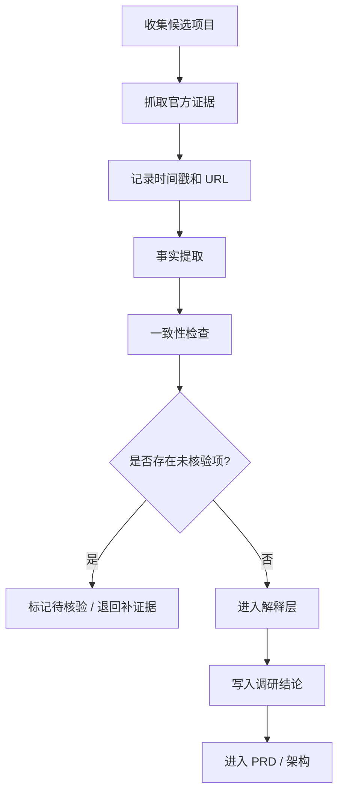

# 研究 Review 架构

更新时间：2026-07-12

## 目的

为开源项目调研、竞品分析、公司主体核验和技术选型建立强制 review 流程，避免把不稳的信息直接写进 PRD、架构或实现计划。

## 这次暴露的问题

1. **来源校验不够硬**
   - repo 热度、项目介绍、公司主体、融资状态被混在一起看。
   - 只要其中一项不稳，整条结论就不该直接落文档。

2. **时间敏感信息没有二次核验**
   - star 数、仓库状态、公司主体状态都可能变化。
   - 未统一记录抓取时间和来源链接，后续无法回溯。

3. **“项目”与“公司”被混淆**
   - GitHub repo 活着，不代表公司主体有效。
   - 公司存在，也不代表对应项目仍在活跃维护。

4. **缺少 review gate**
   - 没有“先证据、后结论”的门禁。
   - 也没有“信息不足则停”的阻断条件。

## Review 分层

### Level 0：原始证据层

允许进入的证据：

- GitHub 仓库主页
- GitHub API 返回的 repo 元数据
- 官方文档 / README / release notes
- 官方域名的产品页 / 帮助中心 / changelog
- 官方博客或公告

必须记录：

- URL
- 抓取时间
- 原文摘要
- 证据类型

### Level 1：事实层

只允许陈述可直接从证据读出的事实：

- 仓库是否存在
- 是否公开
- 是否 archived
- README 是否说明产品用途
- 是否有最近 release / commit / update 信号
- 是否存在官方公司介绍页面

禁止：

- 推断公司是否注销
- 推断商业状态
- 用热度代替产品成熟度

### Level 2：解释层

只允许在明确标注“推断”的前提下做解释：

- 某项目适合哪类产品架构
- 某种技术栈适合哪类实现
- 某类 repo 适合我们借鉴什么

### Level 3：决策层

只有通过 review gate 的信息，才能进入：

- PRD
- 技术路线
- P0/P1 排期
- 对外汇报

## Review Gate

任何候选项目进入“可借鉴名单”前，必须满足：

- repo 仍可访问
- 许可证清晰
- README 可解释项目边界
- 至少一个官方来源可确认项目定位
- star / release / commit 状态已记录时间
- 公司主体状态可核验，或明确标记“未核验”

任一项缺失时：

- 不进入最终榜单
- 不给出确定性结论
- 只能列为“待核验候选”

## 推荐工作流



## 一致性检查

每个项目至少检查：

- repo 名称与官方产品名是否一致
- README、官网、GitHub profile 是否互相指向同一主体
- 公司名是否存在旧称、并购、转移、注销或仅项目不存主体等情况
- 公开页面是否存在时间冲突

## 输出模板

```markdown
项目名：
证据链接：
抓取时间：
事实：
- ...
未核验项：
- ...
结论：
- 仅限事实 / 可推断 / 待核验
```

## 具体防线

### 1. 公司主体核验

如果分析对象是“公司”，必须再查一层：

- 官方公司网站
- 法定主体信息
- 官方社媒或公告
- 注册状态 / 存续状态

查不到就明确写“未核验”，不要补写。

### 2. 热度核验

star 只能作为参考，不可单独用来证明成熟度。

必须同时看：

- 最近 release
- 最近 commit
- issue / discussion 活跃度
- 文档更新

### 3. 适配核验

任何“适合我们”的结论都要回答：

- 它是否真的有我们要的业务对象
- 它是否真的支持可复制的代码结构
- 它是否只是演示层

## 本项目接入方式

在本仓库里，review 架构应进入三层：

1. `docs/review-architecture.md`
2. `docs/open-source-review-register.md`
3. `docs/open-source-research.md`
4. 以后正式做研究时的检索/整理脚本或 agent 流程

当前 GitHub 前辈项目台账见：[open-source-review-register.md](/Users/hanlinye/Desktop/vibe%20作品集/运营自动化企业级agent/docs/open-source-review-register.md)。

## 结论

这次的问题不是单点判断失误，而是**没有把“信息可用”与“信息可写入结论”分开**。  
以后凡是涉及项目、公司、star、融资、主体状态，必须先过 review gate，再进入 PRD 或技术建议。
